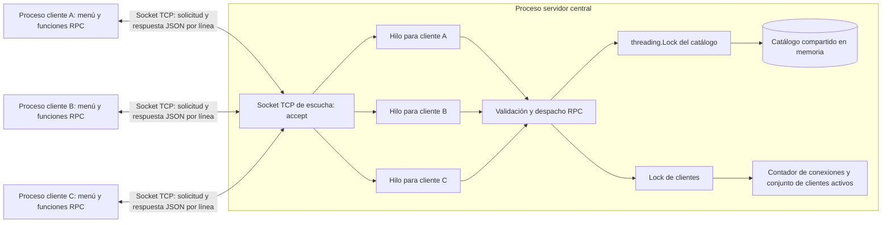
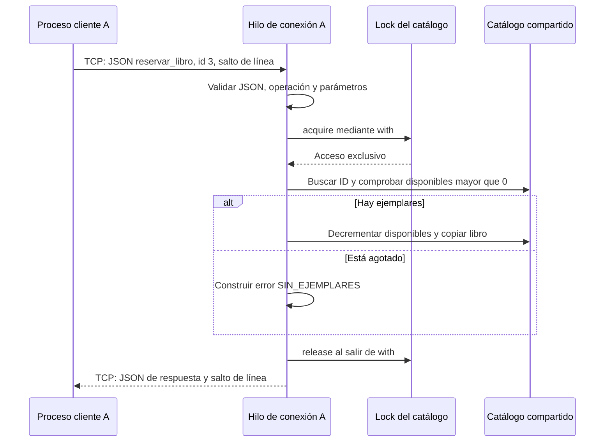

# Parte A. Diseño del sistema

## Arquitectura

El socket de escucha acepta las conexiones y entrega cada socket conectado a un
hilo. Los intercambios posteriores ocurren por ese socket conectado, no por el
socket de escucha. Cada hilo puede atender varias RPC sucesivas del mismo cliente.

## Flujo de una reserva

## Respuestas de diseño

1. **Cliente y servidor.** El cliente recoge entradas, invoca funciones RPC,
   serializa solicitudes y presenta respuestas. El servidor acepta conexiones,
   valida solicitudes, ejecuta las operaciones y conserva el estado autoritativo
   del catálogo. Las copias recibidas por un cliente no modifican el estado remoto.
2. **Información de la solicitud.** Un objeto JSON con `operacion` como texto y,
   para consultar o reservar un libro, `id` como entero positivo. El transporte
   agrega UTF-8 y un salto de línea. No se permiten campos adicionales. Host y
   puerto son parámetros de conexión, no campos de cada solicitud.
3. **Último ejemplar.** Sin sincronización dos hilos podrían leer disponibilidad
   1 y ambos aprobar una reserva. Se vendería dos veces el mismo ejemplar, incluso
   si un intercalado termina guardando 0 en vez de un valor negativo. El Lock cubre
   tanto la comprobación como el decremento. El segundo hilo observa el nuevo 0 y
   devuelve `SIN_EJEMPLARES`. No se depende del GIL para garantizar esta propiedad.
4. **IPC local frente a comunicación entre máquinas.** IPC es comunicación entre
   procesos: localmente puede usar tuberías, memoria compartida o sockets. Entre
   máquinas no hay una memoria física compartida directamente utilizable; se usan
   mensajes de red, direcciones y protocolos. Aparecen latencia, desconexiones y
   fallos parciales: el cliente puede perder contacto mientras el servidor continúa.
   Aquí se usan sockets TCP también en localhost, manteniendo la misma interfaz
   que se emplearía entre máquinas.

## Decisiones de implementación

- Una conexión persistente y RPC secuenciales: una respuesta por solicitud en orden.
  El cliente protege cada intercambio con su propio Lock para evitar cruzar respuestas
  si una instancia se usa desde varios hilos.
- El catálogo se inicializa de nuevo para cada instancia de servidor. Lecturas y
  escrituras usan el mismo Lock; se devuelven copias y se serializan fuera del Lock.
  Un segundo Lock protege las estadísticas y el registro de conexiones.
- Cada conexión del servidor tiene 120 segundos de timeout por inactividad;
  el cliente espera como máximo 10 segundos por conexión/respuesta. El protocolo limita cada
  mensaje a 65536 bytes incluyendo el salto de línea. Se libera el hilo al cerrar,
  producirse un timeout o recibirse una trama inválida.
- TCP es un flujo de bytes: `recv` no equivale a un mensaje. Un lector binario
  persistente con `readline` conserva el resto de una trama o mensajes agrupados.
- El catálogo, las estadísticas y los hilos pertenecen al proceso servidor.
  Los procesos cliente solo comparten el estado a través de la API remota.
